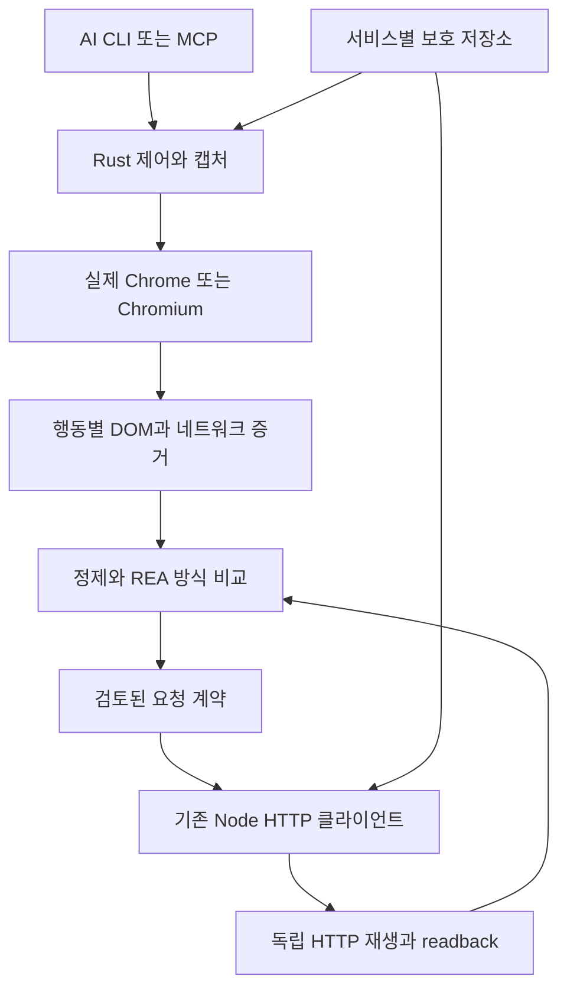

# REA·AI 브라우저 조사와 Rust 분석 계층

조사일: **2026-10-15**. 이 문서는 공식 저장소의 문서와 일부 구현을 검토한 설계 결정이다. 아래의 “미수행·예정”은 최초 조사 시점 기준이다. 후속 [적용 내역](playbook-audit.md)에서 전수조사 CLI, HAR/REA 정제, Rust agent-browser의 격리 fixture runner를 추가했다. 바이너리는 설치했으나 Canary·Stable 데몬 연결이 실패해 브라우저 실증은 미통과다. Rust 컴파일·성능 측정은 수행하지 않았다. [전수조사 결과](../verification/playbook-audit-2026-10-15/README.md)의 새 HTTP 표본과 기존 영수증을 구분한다.

## 결정

**실제 Chrome/Chromium을 실행 엔진으로 유지하고, Rust로 제어·캡처·증거 관리 계층을 구성한다.** 우선 기존 `agent-browser`를 검증하고, 부족한 CDP 관측 기능에만 Rust 확장을 붙인다. REA의 행동별 증거와 비교 모델을 참고한다. 전용 브라우저 UI까지 필요하면 BrowserOS neo를 별도 비교 대상으로 삼는다.

우리 작업에서 브라우저는 로그인 UI, DOM 선택과 클릭, JavaScript 실행, 요청 발생 원인, 화면 상태를 관측하는 데 필요하다. 검증된 검색·상품·옵션 조회의 반복 실행은 기존 독립 HTTP 클라이언트가 맡는다. HTTP로 받아 파싱 가능한 초기 HTML Document도 계약에 포함한다.

Rust 제어 프로그램을 쓴다는 사실과 브라우저 없이 실행한다는 사실은 별개다. 실행 방식은 계속 `browser_automation`, `headless_assisted_http`, `pure_http`로 구분한다.

## 기존 도구에서 채택할 역할

아래는 도입 방향이며 설치 완료 목록이 아니다. 기존 [발견 도구](discovery-tools.md), [재귀 탐색](recursive-discovery.md), [공통 런타임](runtime-modules.md)을 연결 지점으로 사용한다.

| 프로젝트 | 채택할 역할 | 적용 범위 |
|---|---|---|
| [mitmproxy2swagger](https://github.com/alufers/mitmproxy2swagger) | 캡처에서 OpenAPI 초안 내보내기 | 기존 HAR 계약 목록을 보완한다. 예제·헤더에 원본 값이 들어갈 수 있으므로 원본 인증 캡처를 그대로 내보내지 않는다. 자동 생성 명세는 검토 전 초안이다. |
| [oasdiff](https://github.com/oasdiff/oasdiff) | 검토된 명세의 변경 비교 | 관측 범위가 다른 두 캡처를 서비스의 변경으로 단정하지 않는다. 명세 차이와 실제 HTTP 회귀를 함께 확인한다. |
| [Crawlee](https://github.com/apify/crawlee) | HTTP 탐색 큐·재시도·재개 구조 | 기존 서비스 어댑터와 보호 저장소를 연결한다. 현재 frontier는 정제된 증거 체크포인트이며 원본 URL·커서가 있는 실행 큐가 아니다. |
| [Chrome DevTools MCP](https://github.com/ChromeDevTools/chrome-devtools-mcp) | 브라우저 행동·네트워크 관측 기준선 | 발견과 디버깅에 사용한다. 반복 HTTP 실행의 대체물로 분류하지 않는다. |
| [Hurl](https://github.com/Orange-OpenSource/hurl) | 다단계 HTTP 진단 시나리오 | 유지보수 중인 서비스 클라이언트와 별도 진단 도구다. Hurl 통과만으로 기존 클라이언트의 검증을 대신하지 않는다. |
| [Katana](https://github.com/projectdiscovery/katana) | 페이지·엔드포인트 후보 수집 | 발견 후보를 검토한 뒤 frontier에 넣는다. 브라우저를 사용하는 XHR 탐색과 순수 HTTP 수집을 구분한다. |

[js-reverse-mcp](https://github.com/zhizhuodemao/js-reverse-mcp)는 JavaScript 추적 보조 후보로 둔다. [Schemathesis](https://github.com/schemathesis/schemathesis)는 로컬 fixture·staging의 계약 검사 후보로 둔다. 생성되는 요청이 실제 쓰기를 포함할 수 있으므로 운영 서비스에 일괄 적용하지 않는다. `curl_cffi`는 기존 Olive Young 전송 계층에 이미 있어 신규 도입으로 세지 않는다.

## REA에서 가져올 것

검토 대상은 **[morluto/rea — Reverse Engineer Anything](https://github.com/morluto/rea)**다. 조사 기준 commit은 `e45eb33f03deaa2ab047f876736ccaa22498448f`, 라이선스는 MIT다. 웹 관측 기능을 중심으로 평가했다.

### 관측과 분석

기존 Chrome 계열 브라우저에 연결하는 수동 CDP 관측은 DOM·접근성 트리·스크립트·네트워크와 initiator 정보를 다룬다. 외부에서 수행한 행동 전후의 관측 창을 잡는 기능과, 번들에서 경로·엔드포인트 후보를 분석하는 기능이 분리돼 있다. 정적 분석 결과를 실제 요청 계약으로 승격하지 않는 구성이 우리 작업에 맞는다. [REA 브라우저 관측](https://github.com/morluto/rea/blob/e45eb33f03deaa2ab047f876736ccaa22498448f/docs/browser-observation.md)

HAR·SAZ 등 저장 캡처를 조사하는 기능도 있다. 웹 분석만 필요한 단계에서 바이너리 분석 도구 전체를 의존성으로 도입할 이유는 없다. [REA 네트워크 캡처](https://github.com/morluto/rea/blob/e45eb33f03deaa2ab047f876736ccaa22498448f/docs/web-network-captures.md)

### 행동별 재현과 비교

능동 시나리오 실행은 별도 Playwright 공급자가 담당한다. 명시적인 행동과 `step_id`를 기준으로 캡처를 정렬하고, 누락·잘림·다른 수집 범위는 `unknown`으로 남긴다. 자체 실행한 임시 브라우저와 이미 실행 중인 브라우저의 소유권을 구분하는 점도 채택한다. [REA 시나리오 계약](https://github.com/morluto/rea/blob/e45eb33f03deaa2ab047f876736ccaa22498448f/docs/browser-scenario-contract.md)

우리 연결 계층에서 보완할 사항은 다음과 같다.

- 기본 시나리오는 최종 URL 중심이며 DOM·네트워크 본문·스크린샷을 모두 자동 수집하지 않는다. 필요한 항목과 완료 조건을 명시한다.
- 기본 서비스워커 차단 여부를 포함해 캐시·브라우저 환경을 기록한다. 평소 사용 상태와 다른 실행 조건을 동일한 재현으로 취급하지 않는다.
- 시나리오 캡처는 initiator stack을 제공하지 않으므로 요청 호출 경로 분석에는 수동 CDP 관측을 연결한다.
- attach 이전 활동과 초기 popup 등의 누락은 복구된 것으로 표시하지 않는다.
- 일반 URL 쿼리값과 선택한 본문 등이 남을 수 있으므로 REA 산출물을 곧바로 Git 증거로 저장하지 않는다. 현재 플레이북의 정제 규칙과 보호 저장소를 거친다.

특히 응답 본문의 출처를 구분해야 한다. REA 구현은 Playwright `Response.body()`가 CDP 본문을 얻지 못한 경우 인증된 추가 요청의 결과를 돌려줄 가능성을 명시한다. 연결된 transaction ID만으로 원래 응답의 바이트임을 입증할 수 없다. 원래 요청에서 읽은 본문, 추가 조회 결과, 출처 미확인을 각각 기록하고 후자를 원본 응답으로 승격하지 않는다. [본문 증거 구현](https://github.com/morluto/rea/blob/e45eb33f03deaa2ab047f876736ccaa22498448f/src/domain/browserNetworkEvidence.ts)

## AI 브라우저와 Rust 후보 비교

아래의 우선순위는 우리 HTTP 분석·재현 목적에 대한 판단이다. upstream의 지원 설명과 실제 대상 사이트 통과는 별개다.

| 후보 | 확인한 구조·기능 | 우리 용도에 대한 판단 |
|---|---|---|
| [Vercel agent-browser](https://github.com/vercel-labs/agent-browser/blob/dac13bb87468fe9d74a040d862720f6cc17a9565/README.md) | Rust CLI와 Rust 데몬이 CDP로 Chrome을 제어한다. 접근성 참조, 클릭·마우스 입력, 탭, 화면·스냅샷 비교, 네트워크·HAR 기능이 있다. | **첫 검증 대상.** 기존 Chrome을 활용하면서 Rust 제어 기반을 얻는다. 필요한 사건 연결과 본문 출처까지 보장하는지는 fixture로 검사한다. |
| [BrowserOS neo / BrowserOS](https://github.com/browseros-ai/BrowserOS) | Chromium fork 기반 전용 브라우저. neo는 MCP 연결, 행동 타임라인과 로컬 재생 UI를 제공하며 Windows 배포가 있다. | 설치형 AI 브라우저 후보. 전용 작업 UI가 필요할 때 비교한다. 기존 Chrome과 프로필·패치 조건이 다르므로 같은 상태에서 대조한다. |
| [chromiumoxide](https://github.com/mattsse/chromiumoxide/blob/afcc3a4313f2087249b4490d94e54bf8e3bfaccf/README.md) | Rust 비동기 CDP 라이브러리. 기존 브라우저 연결과 실행, 생성된 CDP 명령·이벤트 타입을 제공한다. 이벤트 핸들러를 계속 처리해야 한다. | 누락된 Network·Debugger·Target 관측을 구현할 때의 기반. 완성된 AI 브라우저 제품은 아니다. |
| [Chrome DevTools MCP](https://github.com/ChromeDevTools/chrome-devtools-mcp) | Chrome 개발 도구를 MCP로 제공하는 Node/Puppeteer 계층. | 현재 관측 방식과 새 Rust 계층을 비교하는 기준선. |
| [Stagehand](https://github.com/browserbase/stagehand) | 현재 v4는 로컬 Chrome 또는 Browserbase에서 행동·관측·구조화 추출을 제공한다. | 상위 행동 계획 보조 후보. 추출 성공과 원본 HTTP 계약 검증을 별도 기록한다. |
| [Browser Use](https://github.com/browser-use/browser-use) | 로컬·클라우드 브라우저를 제어하는 AI 에이전트 라이브러리. | 탐색 행동 보조 후보. 이미 있는 에이전트에 또 다른 계획 루프를 추가할 실익부터 측정한다. |
| [PinchTab](https://github.com/pinchtab/pinchtab) | Go HTTP 서버가 Chrome을 제어한다. 기존 CDP 브라우저 연결도 지원한다. | Rust가 필수가 아니라면 비교할 간결한 제어 계층. 현재 기본 탐색 범위는 로컬 사이트여서 외부 사이트용 설정을 별도 확인해야 한다. |
| [Tauri / wry](https://github.com/tauri-apps/wry) | Rust 앱과 OS WebView를 연결한다. Windows는 WebView2, macOS는 WKWebView, Linux는 WebKitGTK를 사용한다. | 증거·비교 결과를 보여주는 UI 후보. 기존 Chrome 세션과 같은 엔진·프로필로 간주하지 않는다. |
| [Servo](https://github.com/servo/servo) | Rust 기반 브라우저 엔진이며 현재 README는 prototype으로 소개한다. | 엔진 자체를 Rust로 만드는 연구 경로. 현재 상거래·로그인·음성 생성의 Chrome 동작 재현에는 우선순위가 낮다. |
| [Lightpanda](https://github.com/lightpanda-io/browser) | Zig와 V8 기반 경량 headless 브라우저. 실제 시각 레이아웃·페인팅을 구현하는 일반 브라우저와 다르다. Windows는 WSL2 경로를 안내한다. | 비시각 추출 실험 후보. 화면 재현의 기준으로 삼지 않는다. JS 브라우저 실행이므로 pure HTTP로 분류하지 않는다. |

`agent-browser`는 이름만 Rust CLI인 구성이 아니다. 조사한 `0.39.1` Cargo manifest와 native daemon 구현에서 Rust CDP 데몬을 확인했다. 다만 브라우저 엔진은 별도 Chrome/Chromium이다. [Cargo manifest](https://github.com/vercel-labs/agent-browser/blob/dac13bb87468fe9d74a040d862720f6cc17a9565/cli/Cargo.toml), [native daemon](https://github.com/vercel-labs/agent-browser/blob/dac13bb87468fe9d74a040d862720f6cc17a9565/cli/src/native/daemon.rs)

`agent-browser`의 파일 기반 상태 저장·인증 vault를 우리 Windows DPAPI 저장소와 같은 것으로 취급하지 않는다. 서비스별 credential 공급자를 연결하고, 평문 상태 파일이나 광범위한 cookie dump 없이 필요한 origin의 값을 메모리로 전달하도록 통합해야 한다. [상태 저장과 인증 옵션](https://github.com/vercel-labs/agent-browser/blob/dac13bb87468fe9d74a040d862720f6cc17a9565/README.md)

BrowserOS neo도 Rust 구현의 실제 사례다. `claw-server`는 Rust MCP/API 서버이며 `browseros-cdp`를 참조한다. 원본 저장소는 AGPL-3.0이므로 소스 이식 시 라이선스와 provenance를 별도 검토한다. 이 조사는 코드를 복사하지 않았다. [서버 Cargo manifest](https://github.com/browseros-ai/BrowserOS/blob/main/packages/browseros-agent/apps/claw-server/Cargo.toml), [CDP crate](https://github.com/browseros-ai/BrowserOS/blob/main/packages/browseros-agent/crates/browseros-cdp/Cargo.toml), [라이선스](https://github.com/browseros-ai/BrowserOS/blob/main/LICENSE)

Stagehand 본체의 현재 로컬 지원을 별도 [stagehand-rust](https://github.com/browserbase/stagehand-rust)의 지원으로 혼동하지 않는다. Rust SDK는 조사 시점 README에서 ALPHA이며 Browserbase 연결을 지원하고 로컬 실행은 예정으로 표시한다. Rust 렌더링 엔진도 아니다.

Lightpanda의 PNG/PDF 출력 여부만으로 Chrome과 같은 스크린샷을 제공한다고 판단할 수 없다. 현재 README의 텍스트 중심 출력과 [공식 아키텍처 문서](https://github.com/lightpanda-io/docs/blob/main/src/content/core-concepts/architecture-overview.mdx)의 레이아웃·스크린샷 제약을 함께 봐야 한다. upstream 속도·메모리 수치를 우리 측정치로 인용하지 않는다.

## 제안 아키텍처

다음은 구현 예정 구조이며 현재 설치된 시스템을 나타내지 않는다.

Rust 범위는 연결·대상 선택·이벤트 처리·비교·CLI/MCP다. 기존 서비스 HTTP 클라이언트는 구조화된 stdin 또는 명시적인 프로세스 인터페이스로 호출한다. Rust `reqwest` 도입 자체가 기존 쿠키·redirect·서명·갱신 계약을 재현해 주지는 않으므로 전송 계층을 일괄 교체하지 않는다.

Tauri UI를 붙인다면 증거 탐색과 비교 표시부터 맡긴다. 대상 사이트는 외부 Chrome에서 계속 실행하고, WebView로 대상 사이트 실행까지 옮기는 작업은 별도 호환성 검증으로 둔다.

### 반드시 보장할 관측 계약

1. **대상과 행동:** 브라우저·탭·frame을 명시적으로 고정한다. DOM/접근성 참조에는 snapshot revision을 붙이고 오래된 참조로 다른 요소를 클릭하지 않는다. 클릭·hover·scroll과 결과 상태를 행동 ID로 연결한다.
2. **수집 시작:** 탐색·클릭 전에 캡처를 시작하고 cursor를 잡는다. Document·Fetch·XHR를 포함하며 작업에 필요한 popup·worker·WebSocket·SSE도 선택한다.
3. **요청 연결:** 요청·응답·완료·실패·redirect ancestry를 연결한다. 빈 결과, 아직 진행 중인 요청, 버퍼 누락, 본문 크기 제한을 구분한다. 무관한 사용자 탭의 요청은 수집 범위에 넣지 않는다.
4. **본문 출처:** 원 요청에서 얻은 본문인지, 도구의 추가 조회인지, 출처 미확인인지 기록한다. 정제 전후 해시와 compressed wire bytes를 혼동하지 않는다.
5. **동일 조건:** viewport·locale·currency·옵션·정렬·필터·계정 범위·캐시·서비스워커 조건을 고정하거나 차이로 기록한다. 상품 ID·옵션·가격 같은 값의 비교는 일치하는 대상에 한정한다.
6. **인증:** 서비스 origin에 한정된 값만 메모리로 전달하고 재사용 값은 기존 DPAPI/ProtectedStore로 보관한다. Git·로그에는 readiness와 정제된 메타데이터만 남긴다.
7. **복구:** 연결 끊김은 `blocked_runtime`으로 기록한다. 캡처와 pending frontier를 남기고 재연결 뒤 다시 관측한다. 외부 소유 브라우저는 연결만 해제한다.
8. **완료 판정:** 브라우저 화면 성공, HTTP 200, 클라이언트 존재, 실제 독립 재생 통과를 구분한다. 불완전한 증거의 비교 결과는 `unknown`이다.

## 구현 전 검증 순서

| 단계 | 산출물 | 통과 기준 |
|---|---|---|
| 1. 로컬 fixture 기준선 | 검색·옵션·페이지네이션·redirect·iframe/popup·stream·binary 응답 시나리오 | 알려진 요청과 수집한 요청이 연결되고 누락·시간 초과가 정확히 표시됨 |
| 2. agent-browser 대조 | 기존 관측 도구와 동일 행동의 캡처 | 탭 오선택 없음, 요청·응답 연결과 본문 출처 검증, 사용자 브라우저 생명주기 보존 |
| 3. REA 증거 연결 | 행동별 정제 캡처와 비교 결과 | 같은/다른/불명확 사례를 구분하고 원본 인증값이 저장되지 않음 |
| 4. 필요한 Rust 확장 | fixture에서 확인한 부족 기능만 구현 | CDP 이벤트 누락·중복·재연결·본문 제한 회귀 통과 |
| 5. 범위를 정한 실제 서비스 | 상품 검색·상세·옵션 또는 음성 옵션 같은 관측과 독립 HTTP 재생 | 실제 내용·schema·동일 대상 값·인증 범위·readback 검증 |
| 6. 선택적 전용 UI | BrowserOS neo 또는 Tauri 비교 기록 | 전용 UI의 이득과 세션·브라우저 조건 차이를 실제 측정 |

음성 생성처럼 결과물과 비용이 발생하는 작업은 옵션 조회와 생성 성공을 분리한다. 생성 검증은 오디오 실제 바이트·형식·저장 이력 등 해당 서비스의 계약에 맞는 readback까지 확인해야 한다. 불확실한 생성 요청은 journal 대사 전에 다시 보내지 않는다.

측정 항목은 행동 성공률, 이벤트·본문 완전성, target 오선택, 직접 HTTP 결과 일치, 재개 가능성, 에이전트 출력량, 소요 시간, 메모리다. 현재 수치는 없으며 특정 후보의 성능 우위를 확정하지 않는다.

## 검토 범위와 다음 작업

- 로컬 기준: 기존 HAR inventory·HTML 후보 추출·frontier 문서와 현재 Node 서비스 구조를 읽었다.
- REA: 브라우저 관측·시나리오 계약·저장 네트워크 캡처 문서와 본문 증거 구현을 읽었다.
- agent-browser: README, Cargo manifest, native daemon과 일부 네트워크·브라우저 코드를 확인했다. 기준 commit은 `dac13bb87468fe9d74a040d862720f6cc17a9565`다.
- chromiumoxide: 기준 commit `afcc3a4313f2087249b4490d94e54bf8e3bfaccf`의 README를 확인했다.
- 나머지 후보: 공식 저장소·문서의 조사일 기준 내용이며 BrowserOS neo는 Rust Cargo manifest도 확인했다. `main` 링크는 이후 변경될 수 있다.
- 로컬 도구 설치·로그인·프로필 가져오기·사이트 실행·벤치마크는 수행하지 않았다. `cargo`와 `rustc`는 현재 셸 PATH에서 발견되지 않았으며 컴파일은 수행하지 않았다.

**다음 구현 단위는 로컬 fixture와 agent-browser 관측 대조다.** 이 결과로 부족한 관측 기능을 특정한 뒤 REA 증거 연결과 Rust 확장 범위를 결정한다.
