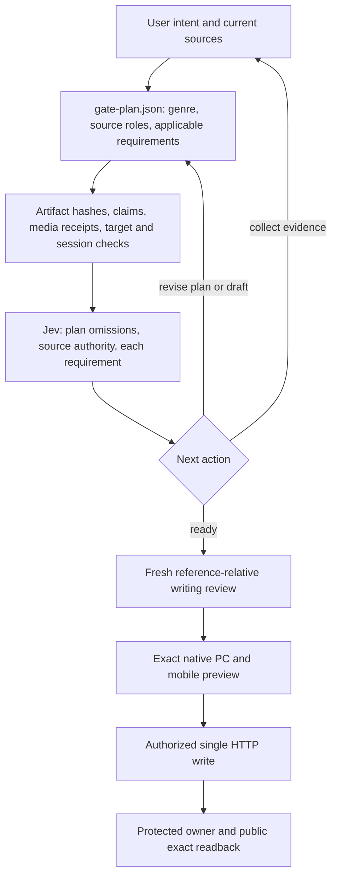

# Adaptive AI article gates and native video

Current standalone checkout: this repository. For runnable PowerShell commands, authentication and journal paths, use [the README](../README.md) and [publishing usage](publishing-usage.md). The dated observations below came from the original workspace.
Implementation added 2026-09-24. This route is for noncommercial AI articles on the existing AI category. Existing legacy jobs keep their dated contracts.

## Workflow

The assistant chooses a plan from the actual reader request. The publisher validates and executes observed HTTP requests.



A fixed number of images, a fixed cover/workflow/checklist trio, and topic-specific source URL code edits are not quality requirements on this route. Authenticated target identity, claim evidence, observed API schemas, rights, exact revisions and single-attempt journals remain mandatory.

## Plan and review artifacts

Set `bundle.gatePlan` and `layoutReference.id: 'adaptive-ai-v1'`. Store the same plan at `gate-plan.json` in the run directory.

Plan fields:

- `schemaVersion:1`, `policyVersion:'adaptive-ai-v1'`, `topicKey`, `genre`.
- `userIntent`, `readerOutcome`, `layoutRationale`: concrete article-specific reasoning.
- `target:{blogId,logNo?,categoryId}`: exact article scope.
- `sources`: each collected source's id, URL, public URL, kind and collection method, plus `role` and `authorityBasis`. Merely labeling a URL official is insufficient: Jev reviews the role against source identities and bound excerpts, while file hashes/excerpts are independently checked.
- `media:{motionRequired,originalRequired,rationale}`: derive this from the request and material claims.
- `requirements:[{id,kind,sourceIds,claimIds,rationale}]`: only applicable modules.

Supported genres: release_report, benchmark_comparison, showcase_roundup, explainer, tutorial.

Requirement modules:

| Module | Applies when | Required evidence |
| --- | --- | --- |
| claim_evidence | Every article | Supported, publishable claims bound to source excerpts |
| reader_action | Every article | A concrete reader takeaway or task |
| benchmark_table | Comparison genre or benchmark claims | Native tables bound to claims; benchmark conditions/scope |
| community_context | Showcase roundups or selected reactions | Attributed community sources and sampling/replication limits |
| motion_demo | User/content requires moving demonstrations | Source-associated uploaded videos with verified processing/hash |
| original_media | User/content requires original media | Source artifact provenance and byte hashes |
| first_party_run | The article shows runs the author performed (e.g. sending a prompt to a model) | `bundle.firstPartyRuns` records (id, model, effort, tool, runCount, prompt/output/provenance SHA-256, editedAfterGeneration:false); `runIds` on the requirement; owned media blocks carry `firstPartyRunIds`; the article text states each run's model and effort. publication-artifacts re-reads the provenance and output files by hash. It never replaces a public claim source. |

Jev checks the plan itself for omitted requirements. It returns ready, collect_evidence, revise_plan, revise_draft or block. Its active receipt is bound to the full plan, document, claim ledger and source context. It cannot waive the deterministic checks or authorize publication. Provider failures never become a pass.

Run directly from the checkout:

```powershell
node apps/naver-blog-api/workflows/republish/adaptive-article-review.mjs --bundle=ABSOLUTE_BUNDLE_JSON --output=NEW_ABSOLUTE_REVIEW_JSON
```

Republish workflow: upload media → update the exact document → run `jev-quality` and `adaptive-gates` → preview → assemble → prepare/authorize/publish. `adaptive-gates` reads gate-plan.json, the current document/ledger/research and reference quality receipt. Assemble binds adaptive-review.json and its file hash into the bundle. A missing/stale review fails; absence of a plan does not automatically convert a legacy job.

New references no longer require a Yozm/Simon domain code edit. reference-sources.json can name another public HTTPS article with an unambiguous article body; `body:{tag:'article'}` is default, with observed id/class selectors available. Incomplete extraction fails. The gate compares useful editorial choices, not literal similarity or popularity counts.

## Direct HTTP video

CLI commands: upload-video, reconcile-video.
Client methods: NaverEditorClient.uploadVideo, reconcileVideo.
Accepted local containers: MP4 and WebM, matching file signatures. File basenames currently use ASCII letters, numbers, underscores or hyphens with a lowercase extension. Local limit: 256 MiB per file; chunks: 5 MiB. This local cap is intentionally below the observed platform limit.

Use absolute paths with the DPAPI launcher; its working directory is the app, not the caller's directory.

```powershell
node C:/Users/User/Skills/naver-blog-publishing/scripts/publisher-direct.mjs --mode=api --command=upload-video --blog-id=aicandoanything --file=ABSOLUTE_VIDEO_FILE --metadata=ABSOLUTE_METADATA_JSON --journal=ABSOLUTE_SAME_JOURNAL --output=NEW_ABSOLUTE_RECEIPT_JSON
```

Metadata JSON contains title (1–40 characters), optional description/tags, and the explicit AI disclosure flag. The account cookies stay scoped to owner verification. Editor authorization goes only to platform.editor.naver.com; the VOD grant/session key goes only to the observed VOD endpoints. Neither is printed or persisted.

Observed stages:

1. Owner-verified editor options.
2. GET platform /api/blogpc001/v2/video-uploader/token.
3. POST nexus.vod.naver.com /warp/2/upload/v4/{videoId}/sessions.
4. POST allocated warp-*.vod.naver.com /upload/v2/files, one acknowledgement per chunk.
5. Read-only GraphQL POST /postman/api/v1/files for ingest, header, original SHA-256, thumbnails and HLS status.
6. Fresh thumbnail download and hash.
7. Verified native video component, source ID, metadata and optional native caption.

The receipt differentiates fileTransferred, processingReady, sourceHashVerified and readbackVerified. A successful transfer alone cannot enter a publication. The journal is reserved before allocation; ambiguous allocation/chunk responses are never blindly resubmitted.

`reconcile-video` uses the same source file and journal. A verified entry gets fresh thumbnail readback. An unfinished upload requires its original runtime upload-session key (NAVER_VIDEO_SESSION_KEY in process memory, never a command argument). A restart without that key stops with VIDEO_RUNTIME_SESSION_REQUIRED; this version does not claim automatic restart/resume of unfinished uploads.

Publication block:

```json
{
  "type": "video",
  "file": "media/demo.mp4",
  "sha256": "SHA256_OF_LOCAL_BYTES",
  "sourceId": "creator-or-owned-source-id",
  "purpose": "Show the motion discussed in this section",
  "rights": {"basis": "owned", "source": "Own demonstration"},
  "mediaMeta": {"title": "Demonstration", "ai": false},
  "videoId": "ID_FROM_VERIFIED_RECEIPT",
  "uploadReceipt": {"...": "exact returned receipt"}
}
```

An immediately following paragraph with presentation:caption becomes the native video caption. Existing owner videos can be reused from the fresh protected model, retaining the byte-hashed local source file. An arbitrary ID or URL cannot substitute for an observed component or verified upload receipt. Uploading media does not create or publish a blog post.

Native preview matches component ID, independently loaded thumbnail, displayed title/time and exact caption, in desktop and mobile modes. The rendered DOM does not expose vid; the preview records that identity boundary explicitly. Protected owner models and public v2_video module data verify the actual video ID during publication readback. Ephemeral public playback keys are discarded.

## Current draft audit

The separate audit under runs/2026-09-24-adaptive-gates examines the latest Claude showcase draft without modifying it. It verifies ten source files and tests the motion requirement against the actual draft. Generated explanatory diagrams and source links do not satisfy a request for moving demonstrations. The audit is not publication authorization.

## Evidence boundaries

The run under runs/2026-09-24-video-publisher retains sanitized upload receipts, blocked native-wire observation, native preview and capability results. No public create/update was issued for these fixtures. Post-publication playback is not claimed by an upload or preview receipt.

## Verification on 2026-09-24

- MP4 and WebM small generated fixtures completed live HTTP upload, processing, original hash verification and thumbnail readback.
- The exact HTTP-compiled video rendered in native desktop/mobile preview with its caption. All browser post writes were blocked.
- 203 scoped regression tests passed, including chunk acknowledgement, uncertain-write journaling, dynamic requirement/source binding and original-media bytes.
- runs/2026-09-24-video-publisher/capability-verification.json binds the sanitized evidence files. Long multi-chunk live uploads and post-publication playback are not claimed by these fixtures.

## Browser-light review loop and model comparisons (2026-09-24)

Run every Naver command from PowerShell: under Git Bash the DPAPI credential store write fails (`CREDENTIAL_STORE_WRITE_FAILED`).

### Review without a browser while drafting

`apps/naver-blog-api/workflows/adaptive-publish/run.mjs` wraps the publication stages for a run directory (document.json, claim-ledger.json, bundle.json, job.json):

```powershell
$W='apps/naver-blog-api/workflows/adaptive-publish/run.mjs'; $R='<run dir>'; $C='<read-only container logNo>'
node $W gates --run=$R                      # deterministic gates
node $W lint --run=$R --container=$C        # HTTP compile + model lint, no browser (~5-25 s)
node $W preview --run=$R --container=$C     # native desktop/mobile preview, once, on the final text
node $W preview-rebind --run=$R             # reuse that preview after metadata-only edits
node $W review --run=$R                     # bind editorial-review-raw.json (separate agent)
node $W jev --run=$R [--attempts=3]         # reference + adaptive Jev; stops on a real judgment
node $W waive-jev --run=$R --instruction="<user words>" --reason="<why>"   # only on explicit user instruction
node $W preview-bind --run=$R
node $W prepare --run=$R; node $W authorize --run=$R --basis="<user request>"
node $W create --run=$R; node $W readback --run=$R; node $W verify --run=$R
```

`lint-model` (publisher CLI command, `scripts/api/model-lint.mjs`) checks what the model determines: title and ordered units, quotation headings, disclosure panel, labeled links, image/video binding to upload receipts, image/video captions, compiled tables, and fetches every image and video thumbnail over HTTP. It classifies layout risk (`needs_native_preview` for tables with more than 3 columns, cell tokens longer than 14 characters, paragraphs over 600 characters, images narrower than 200 px). Geometry is predicted, not rendered, so publication still needs one native preview.

`preview-rebind` accepts an earlier native preview for the current document only when a fresh passing lint proves the same compiled presentation fingerprint and the same render units (for example after claimIds, firstPartyRunIds or plan-only edits). Any visible change requires `preview` again. The create preflight independently recompiles and compares the presentation fingerprint.

The nCaptcha/document input at create time still uses a short headless browser session; the write itself is independent HTTP.

### Same-prompt model comparisons

`apps/naver-blog-api/workflows/model-compare/run.mjs` with `<run>/prompts.json` (`{"suffix":"...","cases":[{"name":"voxel-world","sourceId":"x-...","prompt":"...","seconds":20}]}`):

```powershell
node apps/naver-blog-api/workflows/model-compare/run.mjs generate --run=$R --effort=xhigh   # opus + sol, same effort
node apps/naver-blog-api/workflows/model-compare/run.mjs record --run=$R                     # GPU recording, warm-up trimmed, freeze re-record
node apps/naver-blog-api/workflows/model-compare/run.mjs compose --run=$R                    # side by side, labels include effort
```

Each case runs once per model (Claude Code `claude -p --effort`, tools disabled; Codex `exec`, read-only sandbox). The answer is saved unedited. `verified` is true only when the CLI's own session log reports the requested model and effort. `compose` refuses unverified runs or different prompts. Record the runs in the bundle with the `first_party_run` requirement and state model and effort for both sides in the article.
